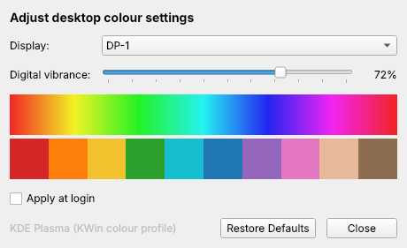

# linux-vibrancy

The NVIDIA Control Panel's **Digital Vibrance** slider, for Linux.



It uses the same scale as Windows: **50 is normal**, 100 is the strongest boost and
0 is greyscale. Greys, black and white are left alone. Only colours get pushed further
away from grey, so they look more vivid without the image getting brighter.

| Session | How it's done | Notes |
| --- | --- | --- |
| **KDE Plasma (Wayland)**, CachyOS's default | Generates an ICC colour profile and hands it to KWin | Works on NVIDIA, AMD and Intel. Per monitor. KDE remembers it across reboots. |
| **Hyprland** | A GLSL screen shader | One level for all monitors |
| **X11 + NVIDIA** | `nvidia-settings` `DigitalVibrance` | The exact same hardware setting as on Windows |
| **X11 + AMD / Intel** | The RandR `CTM` colour matrix | Per monitor |
| GNOME on Wayland, Sway, others | Not supported | These compositors give other programs no way to change saturation |

The right method is picked automatically.

## First: why colours can look washed out on Linux

Vibrance is often not the real problem. Run this before you start boosting:

```sh
vibrance doctor
```

It checks for:

* **Limited RGB range.** This is the most common cause, especially over HDMI. Blacks
  turn dark grey and every colour looks flat. Fix it on KDE with
  `kscreen-doctor output.HDMI-A-1.rgbrange.full`, or in System Settings → Display &
  Monitor → RGB range → Full. On X11 with NVIDIA, use
  `nvidia-settings -a '[DPY:HDMI-0]/ColorRange=0'`.
* **Colour management on a wide-gamut monitor.** If KDE uses the monitor's built-in
  (EDID) profile, sRGB colours are shown *accurately*. Windows stretches them over the
  whole panel gamut instead, which looks more saturated. Setting the colour profile
  to "None" gives the Windows look.
* **Night Light**, YCbCr output on NVIDIA, HDR, and similar settings.

If you had Digital Vibrance above 50% on Windows, set the same number here.

## Install (CachyOS / Arch)

```sh
git clone https://github.com/hgomatheus/linux-vibrancy
cd linux-vibrancy
makepkg -si
```

Then open **Digital Vibrance** from the app menu.

To try it without installing, run it from the checkout:

```sh
sudo pacman -S python-pyqt6
python -m vibrance gui
```

## Usage

```sh
vibrance gui                  # the slider window
vibrance set 70               # every monitor
vibrance set 65 -o DP-1       # one monitor (names come from `vibrance status`)
vibrance reset                # back to normal (50)
vibrance status               # backend, monitors, current levels
vibrance doctor               # look for washed-out-colour causes
vibrance autostart on         # re-apply at login
```

Add `-v` to any command to see the underlying commands it runs. This is handy if
something doesn't work.

### Keeping the setting after a reboot

* **KDE Plasma:** nothing to do. KDE saves the profile in its own display settings.
* **X11:** run `vibrance autostart on`, or tick "Apply at login" in the window.
  The driver forgets the value when X restarts.
* **Hyprland:** add the line that `vibrance autostart on` prints to your config.
  It makes Hyprland load the shader file that this tool keeps up to date. It replaces
  any other `screen_shader` you use, such as a blue-light filter.

## How the KDE version works

KWin color-manages everything it draws. It takes each colour, converts it from sRGB
to whatever your monitor's ICC profile says the monitor can show, then clips anything
out of range. linux-vibrancy writes a profile that claims the monitor's primaries are
slightly *less* saturated than they really are. KWin compensates by pushing every
colour outwards by exactly the vibrance factor. White, grey and brightness stay where
they are.

The profiles live in `~/.local/share/linux-vibrancy/icc/`. While vibrance is active
you'll see one selected under System Settings → Display & Monitor → Color profile.
Going back to 50 restores whatever you had before, including your own calibrated ICC
profile if you used one. In HDR mode KDE uses its own **SDR color intensity** slider
instead. KWin rejects profiles below about 23%, so greyscale isn't possible on KDE.

On X11 with NVIDIA the numbers mean exactly what they mean on Windows. The other
backends use the same scale (saturation × level/50), so 100 is twice as saturated.
They should feel very close.

## Uninstall

```sh
vibrance reset
vibrance autostart off
sudo pacman -R linux-vibrancy
rm -r ~/.config/linux-vibrancy ~/.local/share/linux-vibrancy
```

## Development

```sh
python -m pytest
```

The tests check the colour math, decode the generated ICC profiles the way KWin does,
and run them through LittleCMS (if Pillow is installed). They also drive every backend
against recorded command output.
